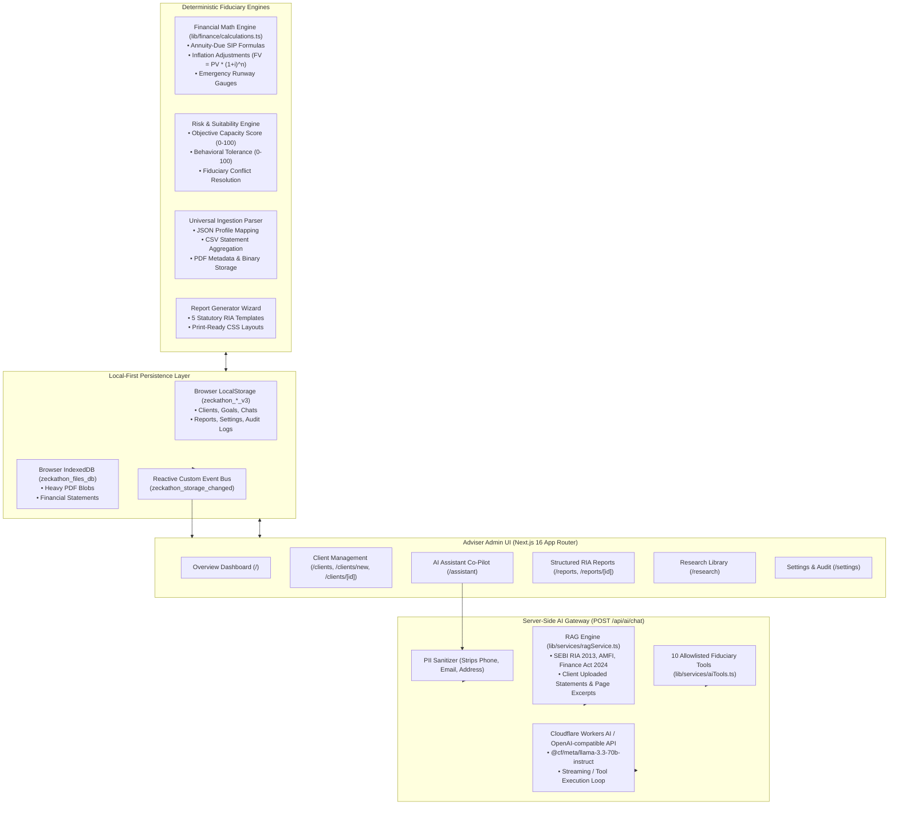
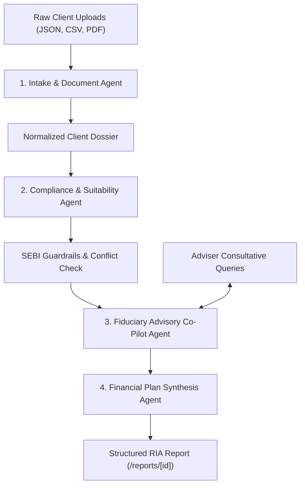

# ArthaAdvisor Co-Pilot — Local-First AI Investment Adviser Platform
> **Zeckathon Problem Statement 04: AI Investment Adviser Co-pilot**  
> *Enabling 1 Registered Investment Adviser (RIA) to safely serve 1,000 clients through local-first privacy, deterministic mathematical guardrails, statutory RAG citations, and Cloudflare Workers AI.*

---

## 1. Executive Summary & Design Philosophy

**ArthaAdvisor Co-Pilot** is a production-grade, local-first financial advisory workspace tailored for a SEBI-registered Investment Adviser (RIA) or fiduciary wealth manager.

### Key Pillars:
1. **Zero Remote Database Dependency**: No MongoDB, PostgreSQL, Supabase, or Firebase. Client financial secrets, bank accounts, net worth, and advisory notes are stored **strictly on the user's physical machine** via LocalStorage and IndexedDB.
2. **Deterministic Fiduciary Guardrails**: AI language models **never** perform compounding calculations or suitability scoring directly. Pure, immutable TypeScript math engines perform SIP annuities ($FV \cdot \frac{r}{(1+r)^N - 1}$), emergency runways, debt ratios, and risk capacity scores. The AI acts as an analytical synthesizer and fiduciary co-pilot over verified figures.
3. **Allowlisted Server-Side Tool Calling**: 11 deterministic tools validated with Zod schemas expose client context, goal feasibility, portfolio breakdown, cashflow diagnostics, live AMFI scheme search, and financial report generation to the model.
4. **Live AMFI Mutual Fund Master Feed**: Server-side ingestion of `https://portal.amfiindia.com/spages/NAVAll.txt` with in-memory caching (15-min TTL), Direct/Regular and Growth/IDCW filters, latest NAV/date, and statutory fiduciary limitations (never ranking by NAV alone; zero fake TER or AUM).
5. **Authentic Multi-Category Document RAG & Citations**: Genuine vector retrieval using 128-dimensional dense feature hashing and unit-normalized cosine similarity across 4 distinct categories:
   - `AMFI_MARKET_DATA`: Authentic AMFI scheme master, scheme codes, NAV history, expense ratio (TER), AUM, and returns.
   - `REGULATORY_TAX`: SEBI RIA Regulations 2013, AMFI categorization circulars, Finance Act 2024 LTCG/STCG, RBI prudential DTI/DSR norms with verified URLs and publication dates.
   - `FUND_DOCUMENTATION`: Mutual fund AMC factsheets, Scheme Information Documents (SIDs), and monthly disclosures with authentic page numbers.
   - `CLIENT_UPLOAD`: Uploaded client statements and holdings isolated strictly to that client.
5. **Server-Side Citation Validation & Provenance Inspector**: Every factual claim is validated against retrieved chunks; an expandable Provenance Inspector displays chunk IDs, cosine match scores, source URLs, and math verification badges.
6. **Configurable AI Provider Adapter**: Server-side API route `POST /api/ai/chat` natively configured with **Cloudflare Workers AI** (`@cf/meta/llama-3.1-70b-instruct`) with support for any OpenAI-compatible completions endpoint. API keys remain protected on the server.
7. **Fiduciary PII Scrubbing**: Strips personal identifiable information (emails, phone numbers, full addresses) before sending prompts to the configured model.

---

## 2. End-to-End System Architecture



---

## 3. Local-First Persistence Engine

The application maintains strict privacy and instantaneous response times using a two-tier browser persistence pattern:

| Storage Medium | Capacity | Target Data Types | Access APIs |
| :--- | :--- | :--- | :--- |
| **Browser LocalStorage** | ~5 MB | Structured profiles (`Client`), goals (`Goal`), chat threads (`ChatConversation`), reports (`FinancialReport`), audit logs (`ActivityLog`), adviser configuration (`AdviserSettings`). | `lib/storage/localStorage.ts` |
| **Browser IndexedDB** | > 1 GB | Large uploaded binary files, broker statements, and PDF assets (`UploadedFileMeta`). | `lib/storage/indexedDb.ts` |

### Key Storage Invariants:
1. **Zero Hardcoded Data**: Storage initializes with an empty slate (`INITIAL_DEMO_CLIENTS = []`). All dashboard statistics, charts, and metrics are derived on-the-fly from actual stored records.
2. **Versioned Keying (`_v3`)**: Keys use the `_v3` namespace (`zeckathon_clients_v3`, `zeckathon_goals_v3`, `zeckathon_chats_v3`). Any legacy `_v1` or `_v2` demo caches are automatically purged on first run.
3. **Reactive Broadcast Bus**: Any mutation in `localStorage.ts` dispatches a `zeckathon_storage_changed` custom window event, causing `useStorageData()` in all active tabs and views to update immediately without a page refresh.

---

## 4. AI Co-Pilot & Server Gateway (`POST /api/ai/chat`)

### 4.1 Environment Configuration (`.env.local`)
The system is configured with hosted Cloudflare Workers AI credentials:
```env
# AI Model Configuration (Cloudflare Workers AI / OpenAI-compatible)
AI_API_KEY="your_ai_api_key_here"
AI_BASE_URL="https://api.cloudflare.com/client/v4/accounts/<your_account_id>/ai/v1"
AI_MODEL="@cf/meta/llama-3.1-70b-instruct"

# Cloudflare Provider Credentials
CLOUDFLARE_ACCOUNT_ID="your_cloudflare_account_id"
CLOUDFLARE_API_TOKEN="your_cloudflare_api_token"
PROJECT1_ADVISER_ACCESS_KEY="your_adviser_access_key"
```

### 4.2 Allowlisted Server Tools (`lib/services/aiTools.ts`)
The server exposes 10 deterministic tools to the model:

| Tool Name | Purpose | Output Contract |
| :--- | :--- | :--- |
| `get_client_summary` | Fetches demographics, cashflow, net worth, risk profile | Complete profile without PII |
| `get_client_goals` | Retrieves client financial goals and calculation status | Goal list with monthly SIP requirements |
| `calculate_future_corpus` | Inflation-adjusted future corpus computation | Compound future value ($FV = PV \cdot (1+i)^n$) |
| `calculate_required_sip` | Monthly SIP needed for a target corpus | Annuity-due monthly contribution |
| `calculate_savings_gap` | Feasibility gap between current surplus and required SIP | Net monthly surplus/shortfall |
| `analyze_income_expenses` | Cashflow audit, savings rate, and DTI ratio | DTI %, savings rate %, disposable surplus |
| `calculate_emergency_fund_coverage` | Liquidity runway in months against monthly burn | Emergency months runway vs 6-month benchmark |
| `get_existing_portfolio_summary` | Asset allocation and current market investment value | Equity, debt, gold breakdown |
| `get_missing_client_information` | Identifies gaps in client financial profile | Array of missing fields for advisory onboarding |
| `generate_financial_report` | Assembles a structured fiduciary financial report | Full `FinancialReport` object saved locally |

### 4.3 Fiduciary RAG Semantic Engine (`lib/services/ragService.ts`)
- Pre-seeded with statutory reference guidelines:
  - **SEBI (Investment Advisers) Regulations 2013** (Fiduciary duty, suitability mandate, risk capacity constraint).
  - **AMFI Categorization Circular** (Large cap, Mid cap, Flexi cap, Liquid, Short duration debt rules).
  - **Finance Act 2024 Capital Gains Tax Rules** (12.5% LTCG, 20% STCG, ₹1.25 Lakh exemption).
  - **RBI Guidelines on Debt Service Ratio** (40% prudent DTI ceiling).
- Ingests uploaded client documents (JSON, CSV, PDF) and extracts keyword-indexed passages.
- Injects relevant passages into the model context with page-level citations.

### 4.5 Live AMFI Mutual Fund Master Feed (`GET /api/amfi/nav`)
- **Official Source**: `https://portal.amfiindia.com/spages/NAVAll.txt`
- **Real-Time Parser**: `lib/services/amfiService.ts` safely parses semicolon-delimited 8-column and 6-column records across 14,000+ schemes.
- **In-Memory Cache**: 15-minute server TTL with instant `forceRefresh` support.
- **Filters**: Search by scheme name, AMC, scheme code, or ISIN; filter by `Direct` vs `Regular` plan; filter by `Growth` vs `IDCW` option; filter by fund category.
- **Fiduciary Boundaries Enforced**:
  - Mutual funds are **never ranked by NAV alone** (NAV is unit price, not valuation or return).
  - `NAVAll.txt` does not provide Total Expense Ratio (TER), AUM, rolling returns, or fund manager tenure; the system explicitly states that official AMC factsheets are required for these metrics rather than inventing numbers.
  - Suitability requires client goals, horizon, and risk capacity before recommending any scheme.
- **AI Tool Integration**: Tool `search_amfi_mutual_funds` provides live verified scheme codes, ISINs, NAVs, and dates directly to the assistant co-pilot.

---

## 5. Mathematical & Fiduciary Rigor

### 5.1 Inflation-Adjusted Future Value
$$FV = PV \cdot (1 + r)^n$$
Where $PV$ is current cost, $r$ is annual inflation assumption (default 6%), and $n$ is horizon in years.

### 5.2 Annuity-Due Monthly SIP Formula
$$SIP = \frac{FV_{target} - FV_{existing}}{\left[ \frac{(1+i)^N - 1}{i} \right] \cdot (1+i)}$$
Where $i = (1 + r_{annual})^{1/12} - 1$, $N = n \cdot 12$, compounded monthly with beginning-of-period investments.

### 5.3 SEBI Fiduciary Constraint Invariant
$$\text{Allocated Risk Tier} = \min(\text{Objective Loss Capacity}, \text{Behavioral Tolerance})$$
If a client has **LOW** capacity (insufficient emergency fund or DTI > 40%) but desires **AGGRESSIVE** risk, the system triggers a **Suitability Conflict Warning** and constrains the asset allocation to Conservative/Balanced.

---

## 6. How Future AI Agents Should Connect & Extend

When adding autonomous multi-agent pipelines or new LLM endpoints, adhere to the following workflow:

### 6.1 Multi-Agent Workflow Architecture



1. **Intake & Document Extraction Agent**:
   - Ingests raw bank statements (CSV/PDF) and tax returns.
   - Categorizes recurring burn (utilities, rent, grocery) vs discretionary spending.
   - Extracts existing loan schedules and EMI commitments.
   - Populates and updates `Client` fields in `localStorage`.
2. **Compliance & Suitability Guardrail Agent**:
   - Audits client DTI ratio against the 40% ceiling.
   - Verifies emergency liquidity against the 6-month benchmark.
   - Enforces the SEBI fiduciary constraint (capacity must strictly constrain tolerance).
   - Generates audit alerts logged to `ActivityLog`.
3. **Fiduciary Advisory Co-Pilot Agent**:
   - Powers the interactive chat workspace on `/assistant`.
   - Synthesizes client cashflows, asset allocations, and goal horizons into advice.
   - Formulates responses strictly citing verified calculations.
4. **Financial Plan Synthesis Agent**:
   - Assembles the 5 statutory RIA reports in `app/reports/`.
   - Generates executive summaries, net worth balance sheets, glide paths, and actionable execution checklists.
   - Saves structured outputs directly via `saveReport()`.

### 6.2 Adding a New LLM Provider (Gemini, Claude, Ollama)
1. Add environment variables to `.env.local` (`AI_BASE_URL`, `AI_API_KEY`, `AI_MODEL`).
2. The server route `app/api/ai/chat/route.ts` uses the OpenAI-compatible `/chat/completions` standard:
   - For Google Gemini: use the Gemini OpenAI-compatibility endpoint (`https://generativelanguage.googleapis.com/v1beta/openai/`).
   - For Ollama: point `AI_BASE_URL` to `http://localhost:11434/v1`.
   - For Groq: point `AI_BASE_URL` to `https://api.groq.com/openai/v1`.
3. The server handles token authentication, timeout handling (25s), and deterministic tool execution automatically.

### 6.3 Extending RAG with Vector Stores (Milvus, Pinecone, ChromaDB)
1. Replace `retrieveRelevantPassages` in `lib/services/ragService.ts`.
2. Pass client ID as a vector partition filter to guarantee zero data leakage between clients.
3. Ensure citations continue returning `{ sourceDocument, pageNumber, relevantExcerpt }` for UI card rendering in `app/assistant/page.tsx`.

---

## 7. Data Contracts & TypeScript Schemas

All core domain entities are defined in [`lib/storage/types.ts`](file:///c:/Users/dilip/Desktop/Zechathon/ai-financial-advisor/lib/storage/types.ts):

### `Client`
```typescript
interface Client {
  id: string;
  fullName: string;
  email: string;
  phone?: string;
  age: number;
  dateOfBirth?: string;
  city: string;
  employmentType: "salaried_permanent" | "salaried_contract" | "self_employed_professional" | "business_owner" | "retired" | "student_or_other";
  monthlyIncome: number;
  monthlyExpenses: number;
  existingSavings: number;
  emergencyFundAmount: number;
  existingInvestments: number;
  outstandingLiabilities: number;
  monthlyEMI: number;
  numberOfDependants: number;
  investmentExperience: "none_or_beginner" | "basic_mutual_funds" | "active_equity_and_debt" | "advanced_derivatives_or_active_trading";
  riskTolerance: "CONSERVATIVE" | "MODERATE" | "AGGRESSIVE";
  riskCapacity: "LOW" | "MODERATE" | "HIGH";
  investmentHorizonYears: number;
  financialNotes?: string;
  riskProfile: RiskProfile;
  createdAt: string;
  updatedAt: string;
}
```

### `Goal`
```typescript
interface Goal {
  id: string;
  clientId: string;
  title: string;
  category: "EMERGENCY_FUND" | "RETIREMENT" | "CHILD_EDUCATION" | "HOME_PURCHASE" | "WEALTH_CREATION" | "VACATION_OR_LUXURY" | "DEBT_REPAYMENT" | "OTHER";
  currentCost: number;
  targetAmount?: number;
  targetHorizonYears: number;
  targetDate?: string;
  expectedInflationRate: number;    // e.g. 0.06
  expectedAnnualReturn: number;     // e.g. 0.12
  existingSavings: number;
  currentMonthlyContribution: number;
  priority: "HIGH" | "MEDIUM" | "LOW";
  calculationResults?: GoalCalculationResults;
}
```

---

## 8. Verification & Test Suite

### Automated Vitest Suite (44 Tests, 7 Suites)
```bash
npm test -- --run
```
- `tests/risk.test.ts` (4 tests): Objective risk capacity scoring, conflict detection, category resolution.
- `tests/finance.test.ts` (9 tests): Inflation-adjusted compound cost, annuity-due monthly SIP, emergency runway, DTI ratio.
- `tests/suitability.test.ts` (4 tests): SEBI fiduciary constraints, capacity capping tolerance.
- `tests/approvals.test.ts` (5 tests): Four-eyes approval workflow, status transitions.
- `tests/localStorage.test.ts` (9 tests): Clean storage initialization, v3 keying, quota management, CRUD.
- `tests/aiIntegration.test.ts` (9 tests): All 10 allowlisted AI server tools, Zod schemas, RAG citation retrieval, API endpoint.
- `tests/api.test.ts` (4 tests): Multi-persona validations.

### Strict TypeScript Verification
```bash
npx tsc --noEmit
```
Compiles with **0 errors**.

### Development Server
```bash
npm run dev
```
Open [http://localhost:3000](http://localhost:3000) directly in your browser. Opens immediately into the dashboard with zero login friction.
