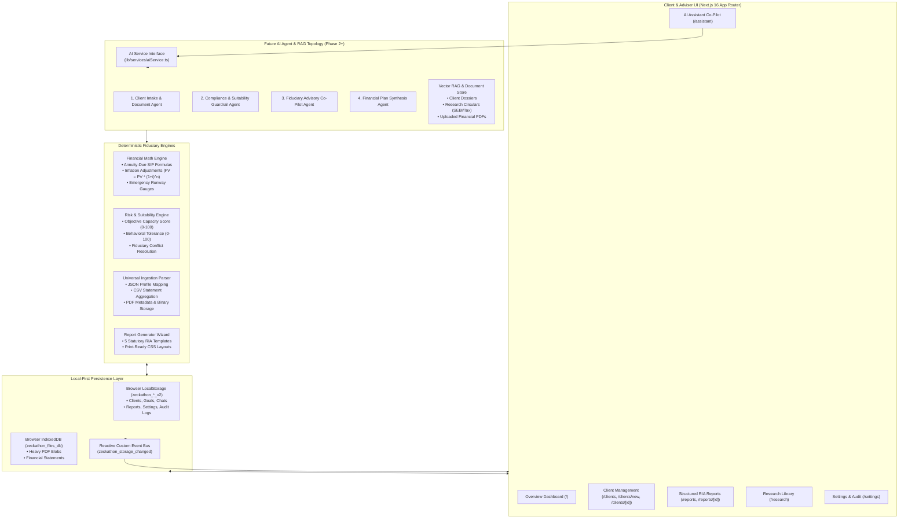
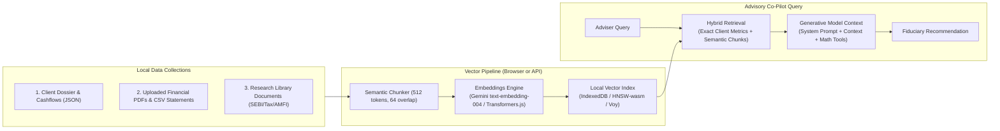
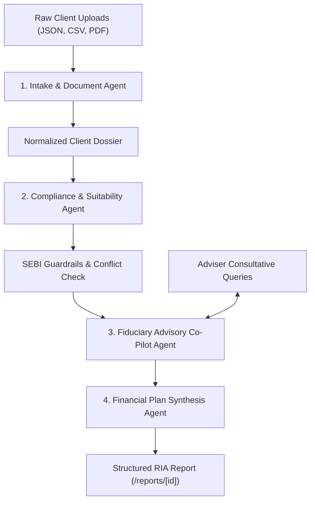

# ArthaAdvisor Co-Pilot — Local-First AI Investment Adviser Platform
> **Zeckathon Problem Statement 04: AI Investment Adviser Co-pilot**  
> *Enabling 1 Registered Investment Adviser (RIA) to safely serve 1,000 clients through local-first privacy, deterministic mathematical guardrails, and an extensible AI consultative co-pilot.*

---

## 1. Executive Summary & Design Philosophy

**ArthaAdvisor Co-Pilot** is a production-grade, local-first financial advisory workspace tailored for a SEBI-registered Investment Adviser (RIA) or fiduciary wealth manager.

### Key Pillars:
1. **Zero Remote Database Dependency**: No MongoDB, PostgreSQL, Supabase, or Firebase. Client financial secrets, bank accounts, net worth, and advisory notes are stored **strictly on the user's physical machine**.
2. **Deterministic Fiduciary Guardrails**: AI language models **never** perform compounding calculations or suitability scoring directly. Pure, immutable TypeScript math engines perform SIP annuities, emergency runways, debt ratios, and risk capacity scores. The AI acts as an analytical synthesizer and fiduciary co-pilot over verified figures.
3. **Graceful Multi-Modal Ingestion**: Ingests client profiles from structured forms, CSV transaction ledgers, JSON exports, and binary PDF financial statements.
4. **Agent-Ready Extensibility**: Designed with clean service interfaces and state event buses so future AI agents, RAG pipelines, and multi-model topologies can plug into the existing system without breaking architecture.

---

## 2. End-to-End System Architecture



---

## 3. Local-First Persistence Engine

The application maintains strict privacy and fast response times using a two-tier browser persistence pattern:

| Storage Medium | Capacity | Target Data Types | Access APIs |
| :--- | :--- | :--- | :--- |
| **Browser LocalStorage** | ~5 MB | Structured profiles (`Client`), goals (`Goal`), chat threads (`ChatConversation`), reports (`FinancialReport`), audit logs (`ActivityLog`), adviser configuration (`AdviserSettings`). | `lib/storage/localStorage.ts` |
| **Browser IndexedDB** | > 1 GB | Large uploaded binary files, broker statements, and PDF assets (`UploadedFileMeta`). | `lib/storage/indexedDb.ts` |

### Key Storage Invariants:
1. **Zero Hardcoded Data**: Storage initializes with an empty slate (`INITIAL_DEMO_CLIENTS = []`). All dashboard statistics, charts, and metrics are derived on-the-fly from actual stored records.
2. **Versioned Keying**: Keys use `_v2` namespaces (`zeckathon_clients_v2`, `zeckathon_goals_v2`). Any legacy `_v1` demo caches are automatically purged on first run.
3. **Reactive Broadcast Bus**: Any mutation in `localStorage.ts` dispatches a `zeckathon_storage_changed` custom window event, causing `useStorageData()` in all active tabs and views to update immediately without a page refresh.

---

## 4. Current Core Modules (What Is Built)

### 1. Overview Dashboard (`/`)
- Real-time KPI scorecard calculated from records: Total Active Clients, Plans Created, AI Conversations Saved, Pending Review Audits.
- Interactive **Recharts** visualizations:
  - *Goal Distribution*: Bar chart mapping goals across wealth creation, retirement, education, and buffer categories.
  - *Risk Profile Breakdown*: Donut chart displaying clients across Conservative, Moderately Conservative, Balanced, Growth, and Aggressive tiers.
- Quick actions: `+ Add Client`, `Upload Data`, `New AI Chat`, `Generate Report`.
- Audit timeline logging every profile creation, edit, and report export.

### 2. Client Management (`/clients`)
- Search, filter by Risk Level, Employment Type, and Emergency Buffer Runway.
- Table and Grid card layouts.
- Client deletion modal with cascade cleanup of associated goals and chat threads.
- **Client Onboarding (`/clients/new`)**: 3-step wizard with live real-time financial diagnostics (Surplus, Emergency Runway, DTI, Risk Capacity score) that recalculates as numbers are typed.
- **Client Profile Dossier (`/clients/[id]`)**: 6 specialized tabs:
  - `Overview`: Net worth, asset/liability balance sheet, liquidity gauge.
  - `Goals`: Goals manager with inflation-adjusted future target and required monthly SIP.
  - `Risk & Suitability`: Capacity vs tolerance matrix with conflict warning banners.
  - `Uploaded Files`: Viewer for ingested JSON, CSV, and PDF records.
  - `AI Conversations`: History of past AI chats with "Continue Thread" actions.
  - `Generated Reports`: Historical financial plans created for this client.
- **Client Profile Editor (`/clients/[id]/edit`)**: Profile updates with form hydration and immediate capacity recalculations.

### 3. AI Assistant Co-Pilot (`/assistant`)
- Consultative chat workspace linked to selected client profiles.
- Left drawer: Live client financial snapshot (Income, Burn, Runway, Conflict alerts) and saved conversation threads.
- Main pane: Real-time dialogue with suggested fiduciary prompt pills (e.g., *"Evaluate emergency fund runway"*, *"Check risk tolerance vs capacity conflict"*, *"Calculate required SIP for primary goal"*).
- Transparent disclosure indicator denoting local rule-based math or live model synthesis.

### 4. Financial Reports (`/reports` & `/reports/[id]`)
- Automated report generator with 5 standard RIA templates:
  1. *Comprehensive Financial Plan*
  2. *Cashflow & Net Worth Audit*
  3. *Retirement Readiness Assessment*
  4. *Risk Profile & Asset Allocation Review*
  5. *Goal Funding & Investment Strategy*
- High-fidelity, print-ready document view with SEBI RIA registration header, executive summary, asset allocation charts, suitability findings, and implementation action checklists. Includes `@media print` styling for clean PDF export.

### 5. Research Library (`/research`)
- Regulatory and statutory reference knowledge base.
- Pre-seeded with SEBI Investment Advisers Regulations 2013, AMFI Categorization Guidelines, and FY 2024-25 Income Tax Slabs.
- Upload custom PDF/CSV research documents with tag search.

### 6. Settings & System Administration (`/settings`)
- Adviser credentials (Name, SEBI RIA Registration Number, Firm Name, Email, Office City).
- Storage quota meter (Kilobytes used, % of quota, entity count).
- Data Backup & Recovery: One-click export to `backup.json`, restore from `backup.json`, and wipe storage.
- AI Configuration: Provider toggle (`LOCAL_RULE_BASED` vs `GOOGLE_GEMINI` / `OPENAI`), API key input, and model selector (`gemini-1.5-pro`, `gemini-1.5-flash`, etc.).

---

## 5. Mathematical & Fiduciary Formulations

All mathematical calculations are implemented in pure TypeScript functions to ensure deterministic execution and zero hallucinations:

### 1. Inflation-Adjusted Future Value ($FV$)
$$FV = PV \times (1 + i)^n$$
- $PV$: Current estimated cost of the goal
- $i$: Annual assumed inflation rate (default $6\%$)
- $n$: Target horizon in years

### 2. Future Value of Existing Dedicated Investments ($FV_{\text{existing}}$)
$$FV_{\text{existing}} = PV_{\text{existing}} \times (1 + r)^n$$
- $r$: Expected annual return of allocated asset class

### 3. Net Funding Shortfall
$$\text{Shortfall} = \max(0, FV - FV_{\text{existing}})$$

### 4. Required Monthly SIP (Annuity-Due Formula)
$$r_m = \frac{r}{12}, \quad N = n \times 12$$
$$\text{SIP} = \frac{\text{Shortfall} \times r_m}{((1 + r_m)^N - 1) \times (1 + r_m)}$$

### 5. Multi-Factor Objective Risk Capacity Score ($0 - 100$)
$$\text{Score} = 50 + \Delta_{\text{emergency}} + \Delta_{\text{DTI}} + \Delta_{\text{age}}$$
- $\Delta_{\text{emergency}}$: $+20$ if runway $\ge 6$ months; $-15$ if runway $< 3$ months.
- $\Delta_{\text{DTI}}$: $-20$ if DTI $> 40\%$; $+10$ if DTI $< 20\%$.
- $\Delta_{\text{age}}$: $+15$ if age $< 40$; $-15$ if age $> 60$.

### 6. SEBI Fiduciary Constraint Rule:
$$\text{Harmonized Category} = \min(\text{Objective Capacity}, \text{Subjective Tolerance})$$
*If a client claims an "Aggressive" tolerance but objective capacity is "Low" (e.g. high debt or low reserves), the fiduciary co-pilot strictly enforces a "Conservative" allocation and flags a suitability conflict.*

---

## 6. Future AI Agent & RAG Integration Blueprint

> **CRITICAL DIRECTIVE FOR FUTURE AI AGENTS & ENGINEERS:**  
> When integrating generative AI models, vector search, or autonomous agents into this platform, adhere strictly to the conventions and integration points documented below.

### 6.1 The Non-Negotiable Integration Rules
1. **Never Calculate Math via LLM Text**: Never prompt an LLM to compute compound interest or SIPs directly in prose. Always pass computed metrics from the local math functions into the LLM context or register the math functions as **LLM Tools / Function Calls**.
2. **Read-Only Client Dossier**: The AI co-pilot must receive a structured, sanitized snapshot of the client's financial dossier (`AIQueryContext`).
3. **Transparent Disclosure**: Every response generated by an external LLM must carry `isPlaceholder: false` and cite the model in `disclosureNote`.
4. **Local State Commit**: When an AI agent recommends a profile update, goal adjustment, or report draft, it must format the output to match the application's TypeScript interfaces (`Client`, `Goal`, `FinancialReport`) and commit it via `lib/storage/localStorage.ts`.

---

### 6.2 AI Service Interface Specification

The entry point for all AI consultations is [`lib/services/aiService.ts`](file:///c:/Users/dilip/Desktop/Zechathon/ai-financial-advisor/lib/services/aiService.ts):

```typescript
export interface AIQueryContext {
  client: Client;
  goals: Goal[];
  reports?: FinancialReport[];
  files?: UploadedFileMeta[];
  history: ChatMessage[];
  settings?: AdviserSettings;
}

export interface AIAdvisoryResult {
  text: string;                     // Markdown-formatted response for the adviser
  intent: string;                   // Resolved advisory intent
  metrics?: Record<string, any>;     // Deterministic values referenced in answer
  recommendations?: string[];       // Actionable next steps
  isPlaceholder: boolean;           // False when generated by real model
  disclosureNote: string;           // Regulatory transparency note
}

export async function generateAdvisoryResponse(
  prompt: string,
  context: AIQueryContext
): Promise<AIAdvisoryResult>;
```

---

### 6.3 Retrieval-Augmented Generation (RAG) Architecture

To enable the AI to cite client financial records and regulatory guidelines accurately, wire RAG across three primary knowledge collections:



#### What to Index in the Vector Store:
1. **Client Records Vector Store (`client_vectors`)**:
   - Parsed CSV bank statement transaction summaries.
   - Client goals, time horizons, and personal risk notes.
   - Uploaded PDF financial assets and portfolio holdings.
2. **Statutory & Research Vector Store (`research_vectors`)**:
   - Content from the `Research Library` (`/research`).
   - SEBI circulars on suitability, commission disclosures, and investor risk profiling.
   - Income tax slab rules, capital gains taxation (LTCG / STCG).

---

### 6.4 Mandatory Function Calling (LLM Tools)

When connecting autonomous or semi-autonomous AI models (e.g. Gemini Function Calling, OpenAI Tools, Anthropic Tool Use), declare the local math services as executable functions:

```typescript
export const ADVISER_AI_TOOLS = [
  {
    name: "calculateSIPRequirement",
    description: "Calculates the exact monthly SIP needed to fund a goal using the annuity-due compounding formula.",
    parameters: {
      type: "object",
      properties: {
        currentCost: { type: "number", description: "Current present cost in INR" },
        horizonYears: { type: "number", description: "Target horizon in years" },
        expectedReturnRate: { type: "number", description: "Annualized expected return (e.g. 0.12 for 12%)" },
        inflationRate: { type: "number", description: "Annualized expected inflation (default 0.06)" },
        existingSavings: { type: "number", description: "Existing savings already allocated" }
      },
      required: ["currentCost", "horizonYears", "expectedReturnRate"]
    }
  },
  {
    name: "evaluateSuitabilityConflict",
    description: "Evaluates objective risk capacity against subjective risk tolerance and enforces fiduciary constraint.",
    parameters: {
      type: "object",
      properties: {
        capacityScore: { type: "number", description: "Calculated capacity score (0-100)" },
        toleranceLevel: { type: "string", enum: ["CONSERVATIVE", "MODERATE", "AGGRESSIVE"] }
      },
      required: ["capacityScore", "toleranceLevel"]
    }
  },
  {
    name: "auditEmergencyRunway",
    description: "Calculates months of emergency runway and identifies cash shortfall against the 6-month benchmark.",
    parameters: {
      type: "object",
      properties: {
        emergencyFundAmount: { type: "number" },
        monthlyExpenses: { type: "number" },
        monthlyEMI: { type: "number" }
      },
      required: ["emergencyFundAmount", "monthlyExpenses", "monthlyEMI"]
    }
  }
];
```

---

### 6.5 Multi-Agent Topology for the Co-Pilot

For comprehensive autonomous advisory workflows, organize incoming agents into the following four distinct roles:



1. **Intake & Document Extraction Agent**:
   - Ingests raw bank statements (CSV/PDF) and tax returns.
   - Categorizes recurring burn (utilities, rent, grocery) vs discretionary spending.
   - Extracts existing loan schedules and EMI commitments.
   - Populates and updates `Client` fields in `localStorage`.
2. **Compliance & Suitability Guardrail Agent**:
   - Audits client DTI ratio against the $40\%$ ceiling.
   - Verifies emergency liquidity against the 6-month benchmark.
   - Enforces the SEBI fiduciary constraint (capacity must strictly constrain tolerance).
   - Generates audit alerts logged to `ActivityLog`.
3. **Fiduciary Advisory Co-Pilot Agent**:
   - Powers the interactive chat workspace on `/assistant`.
   - Synthesizes client cashflows, asset allocations, and goal horizons into advice.
   - Formulates responses strictly citing verified calculations.
4. **Financial Plan Synthesis Agent**:
   - Assembles the 5 statutory RIA reports in `app/reports/`.
   - Generates executive summaries, net worth balance sheets, glide paths, and actionable execution checklists.
   - Saves structured outputs directly via `saveReport()`.

---

### 6.6 Step-by-Step Guide: How to Wire a Live AI Provider

1. **Obtain API Key**: Enter your Google Gemini, OpenAI, or Anthropic API key in **Settings (`/settings`)**.
2. **Inspect Provider Configuration**: Read `settings.aiProvider`, `settings.apiKey`, and `settings.selectedModel` via:
   ```typescript
   import { getAdviserSettings } from "@/lib/storage/localStorage";
   const settings = getAdviserSettings();
   ```
3. **Connect in `lib/services/aiService.ts`**: The hook `callGeminiAPI` is already scaffolded. To wire Anthropic or OpenAI, add an equivalent caller function:
   ```typescript
   if (settings?.aiProvider === "OPENAI" && settings.apiKey) {
     return await callOpenAIAPI(prompt, context, settings.apiKey, settings.selectedModel);
   }
   ```
4. **Inject System Fiduciary Prompt**: Provide the complete client dossier into the system instructions:
   ```markdown
   You are an expert SEBI Registered Investment Adviser (RIA) co-pilot.
   - Prioritize client capital preservation and debt-to-income limits.
   - Never promise guaranteed returns.
   - Use the provided deterministic metrics for all numbers.
   - Format responses in clean GitHub-flavored Markdown.
   ```
5. **Commit Conversations**: Save the assistant's message back to the thread using:
   ```typescript
   import { addMessageToConversation } from "@/lib/storage/localStorage";
   addMessageToConversation(conversationId, {
     sender: "assistant",
     text: result.text,
     metadata: result.metrics
   });
   ```

---

## 7. Data Contracts & TypeScript Schemas

All core domain entities are defined in [`lib/storage/types.ts`](file:///c:/Users/dilip/Desktop/Zechathon/ai-financial-advisor/lib/storage/types.ts):

### `Client`
```typescript
interface Client {
  id: string;
  fullName: string;
  email: string;
  phone?: string;
  age: number;
  dateOfBirth?: string;
  city: string;
  employmentType: "salaried_permanent" | "salaried_contract" | "self_employed_professional" | "business_owner" | "retired" | "student_or_other";
  monthlyIncome: number;
  monthlyExpenses: number;
  existingSavings: number;
  emergencyFundAmount: number;
  existingInvestments: number;
  outstandingLiabilities: number;
  monthlyEMI: number;
  numberOfDependants: number;
  investmentExperience: "none_or_beginner" | "basic_mutual_funds" | "active_equity_and_debt" | "advanced_derivatives_or_active_trading";
  riskTolerance: "CONSERVATIVE" | "MODERATE" | "AGGRESSIVE";
  riskCapacity: "LOW" | "MODERATE" | "HIGH";
  investmentHorizonYears: number;
  financialNotes?: string;
  riskProfile: RiskProfile;
  createdAt: string;
  updatedAt: string;
}
```

### `Goal`
```typescript
interface Goal {
  id: string;
  clientId: string;
  title: string;
  category: "EMERGENCY_FUND" | "RETIREMENT" | "CHILD_EDUCATION" | "HOME_PURCHASE" | "WEALTH_CREATION" | "VACATION_OR_LUXURY" | "DEBT_REPAYMENT" | "OTHER";
  currentCost: number;
  targetAmount: number;             // Inflation-adjusted future value
  targetHorizonYears: number;
  expectedInflationRate: number;    // e.g. 0.06
  expectedAnnualReturn: number;     // e.g. 0.12
  existingSavings: number;
  currentMonthlyContribution: number;
  priority: "HIGH" | "MEDIUM" | "LOW";
  calculationResults: {
    inflationAdjustedCost: number;
    futureValueOfExistingSavings: number;
    netShortfall: number;
    requiredMonthlySIP: number;
    onTrackStatus: "ON_TRACK" | "NEEDS_ATTENTION" | "CRITICAL_SHORTFALL";
  };
}
```

---

## 8. Development & Verification Commands

### Prerequisites
- Node.js 18+ (tested on Node.js 20 & 22)
- npm or pnpm

### Run Automated Vitest Test Suite
```bash
npm test -- --run
```
Executes all **35 automated unit and integration tests** verifying:
- Local storage CRUD, serialization, and quota tracking
- Inflation-adjusted compound corpus and annuity-due SIP math
- Objective risk capacity scoring and conflict detection
- SEBI suitability guardrails and emergency runway calculations
- AI advisory query routing and placeholder disclosures

### Run TypeScript Compilation Verification
```bash
npx tsc --noEmit
```
Verifies strict TypeScript type-checking across all pages, components, and storage services (0 errors).

### Start Development Server
```bash
npm run dev
```
Open [http://localhost:3000](http://localhost:3000) directly in your browser. The application opens directly into the executive dashboard with zero login friction.

---

## 9. Summary for Future AI Agents

```
========================================================================================
                              ARTHAADVISOR AI HANDOFF SUMMARY
========================================================================================
1. Storage Engine       : LocalStorage (_v2 keys) + IndexedDB (files). NO remote DB.
2. Math Calculations    : Pure TypeScript functions (lib/services/financeMath.ts).
                          NEVER compute SIPs, runways, or capacity via LLM text.
3. AI Service Hook      : lib/services/aiService.ts (generateAdvisoryResponse).
4. Tool Calling         : Use declared tools in Section 6.4 for compounding math.
5. Ingestion Pipeline   : lib/services/fileParser.ts (JSON, CSV, PDF).
6. Compliance Mandate   : Capacity constrains Tolerance. Cap DTI at 40%. Benchmark 6mo burn.
========================================================================================
```
